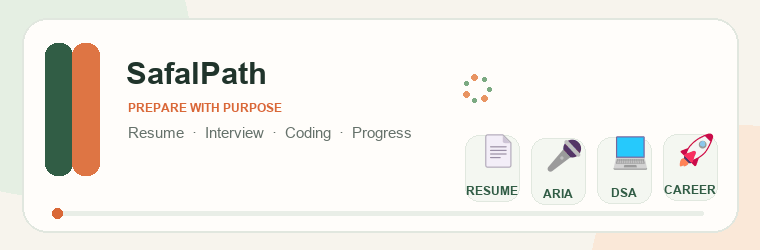

<h1 align="center">🌱 SafalPath</h1>
<p align="center"><b>Your next role starts with your next step.</b></p>

<p align="center">
  
</p>

<p align="center">
  
  
  
  
  
</p>

**SafalPath** is a full-stack career-preparation workspace for students and early-career applicants. It brings resume review, job-description matching, guided interview practice, coding/DSA practice, and progress tracking into one authenticated application.

> 🚀 **MVP / academic project:** AI scores and suggestions are practice aids, not hiring decisions. The coding arena checks a visible sample, not hidden test cases. Review generated resume content before using it.

## ✨ What you can do

- 📄 **Review a resume:** paste text or upload a selectable-text PDF/TXT, choose a target role, inspect skills and common issues, and get a structured draft.
- 🧾 **Build and export:** choose from four resume layouts (Classic, Modern, Compact, Executive), edit a live preview, save the draft to your account, and print/save a clean A4 PDF.
- 🎯 **Match a job description:** compare your saved resume with a role and review matched skills, missing terms, and next steps.
- 🗺️ **Create a study roadmap:** generate week-by-week activities based on target role, skill gaps, available weeks, and hours per day.
- 🎤 **Practice with Aria:** complete a five-question role-focused interview with spoken prompts, typed or microphone answers, feedback, and scores.
- 🤖 **Ask Margdarshak:** get placement guidance for resume, interview, DSA, role preparation, and study planning.
- 🧠 **Practice DSA:** select topics and company-style practice patterns, then launch a fresh LeetCode-style exercise in the Arena.
- 💻 **Use the Arena compiler:** edit JavaScript, Python, C++, or Java function starters, run sample code through Piston, and inspect the output.
- 🏅 **Track progress:** earn XP, maintain streaks, complete daily/weekly challenges, unlock badges, customize your avatar, and view the leaderboard.
- 🔎 **Find job boards:** open role/location searches on external job sites and company career pages.

## 🧰 Technology

| Layer | Tools |
| --- | --- |
| Web client | React, Vite, React Router, Axios, Recharts, Lucide, CSS |
| API | Node.js, Express, JWT, bcryptjs, Multer |
| Data | MongoDB and Mongoose |
| Generative AI | Groq Chat Completions API; model configured with `GROQ_MODEL` |
| Speech-to-text | Groq Audio Transcriptions API; model configured with `GROQ_TRANSCRIPTION_MODEL` |
| Resume extraction | `pdf-parse` for selectable PDF text; image-only/scanned PDFs require OCR first |
| Code execution | Piston external execution API for JavaScript, Python, C++, and Java |

## 🏗️ Architecture

```text
Browser (React)
  Pages + AuthContext + Axios Bearer-token interceptor
                 |
                 | JSON / multipart HTTP requests
                 v
Express REST API
  Auth middleware | AI routes | User/progress routes
        |                 |                   |
        v                 v                   v
   MongoDB/Mongoose      Groq API             Piston API
                         chat + audio         code execution
```

The browser handles page rendering, form state, speech capture, and Aria's spoken prompts. The backend validates the JWT, reads/writes the signed-in user's MongoDB document, extracts resume text, and calls Groq or Piston when needed. The Groq key belongs only in the backend environment; `VITE_` variables are delivered to the browser and must never contain secrets.

## 🔄 Main user flow

1. Open the landing page and create an account or sign in.
2. The API verifies the account and returns a seven-day JWT. The client stores it and requests `/api/auth/me` when the app reloads.
3. Protected workspace routes require a signed-in user. Axios attaches the Bearer token to protected API requests.
4. Start with a resume review or choose a target role from the dashboard.
5. Use the resume, roadmap, interview, DSA, and coding tools. Backend mutations return the updated user and level so the UI stays in sync.
6. Visit Rewards to review XP, streak, badges, challenges, and leaderboard progress.
7. Use Job Boards to search externally and apply on the destination site.

### Resume review and PDF flow

1. Select a target role and upload a PDF/TXT (maximum 5 MB) or paste resume text.
2. The authenticated API receives a multipart request. Multer keeps the uploaded file in memory; `pdf-parse` extracts selectable PDF text.
3. Groq generates a role-focused review when configured. Deterministic checks supplement common contact, structure, date, duplicate-line, placeholder, and readability findings.
4. If text generation is unavailable, local rules produce a labeled heuristic review and a draft outline.
5. The user document stores resume text, rewrite, target role, score, skills, and gaps. The builder uses the draft as a starting point.
6. Edit and verify the facts, replace placeholders, then use **Print / save PDF** in the browser.

Scanned/image-only PDFs have no selectable text and need OCR before upload. No automated review can find every issue or guarantee a shortlist.

### Aria microphone flow

1. Start a mock interview and allow microphone access when the browser asks.
2. Hold/press the microphone button to record; press it again to stop.
3. The authenticated `/api/ai/transcribe` route forwards the short audio recording to Groq's speech-to-text endpoint when `GROQ_API_KEY` is set.
4. The transcript appears in the answer field. Review or edit it, then press **Send answer** to ask Aria for interview feedback.
5. If audio transcription is unavailable, use **Try browser dictation** where supported or type the answer.

Audio is sent to the backend and Groq for transcription; the app route keeps the upload in memory and does not save the recording in MongoDB. Aria's spoken prompts use browser speech synthesis. The optional camera is a local preview and is not uploaded by the interview flow. Microphone use requires a secure browser context (HTTPS or `localhost`) and permission.

### DSA-to-compiler flow

1. Choose topics and company-style practice in DSA Recommender.
2. Select **Practice in compiler** on a recommendation.
3. The Arena asks Groq for a fresh practice challenge based on the recommendation's pattern and opens the editor with language-specific function boilerplate.
4. Run the sample through Piston. The API compares the last non-empty output line to the expected sample output.
5. A passing sample can be submitted for progress credit. The Arena does not currently run hidden tests; use the external problem link for the exact referenced question.

## 🚀 Run locally

### Prerequisites

- Node.js and npm versions compatible with the Vite version in `frontend/package.json`.
- A MongoDB instance (local or hosted).
- A Groq API key for live generation and audio transcription. The app's local Aria/Margdarshak/resume fallbacks still work for their supported cases without text-generation access.

### 1. Configure the backend

```bash
cd backend
npm install
```

Copy `backend/.env.example` to `backend/.env` and set the values:

```dotenv
PORT=5000
MONGO_URI=mongodb://127.0.0.1:27017/safalpath
JWT_SECRET=replace-with-a-long-random-secret
GROQ_API_KEY=your-private-groq-api-key
GROQ_MODEL=llama-3.3-70b-versatile
GROQ_TRANSCRIPTION_MODEL=whisper-large-v3-turbo
```

Keep `.env` private. Do not commit API keys or put them in frontend variables. Change the MongoDB connection string for a hosted database. Use a unique, long JWT secret in each environment.

Start the backend:

```bash
npm run dev
```

The API listens on port `5000` by default. Visit `http://localhost:5000/api/health` to inspect API status, database connection, and Groq configuration.

### 2. Configure the frontend

In another terminal:

```bash
cd frontend
npm install
```

Copy `frontend/.env.example` to `frontend/.env.local` and configure the API base URL if needed:

```dotenv
VITE_API_URL=http://localhost:5000/api
```

Start Vite:

```bash
npm run dev
```

Open the local URL printed by Vite. Sign-up/sign-in require the backend and MongoDB to be available; the app does not create a fake account when authentication fails.

## 🔐 Authentication and account data

- `POST /api/auth/register` creates a user and signs a JWT.
- `POST /api/auth/login` verifies credentials and signs a JWT.
- `GET /api/auth/me` validates the current JWT and returns the authenticated profile.
- Protected API routes use auth middleware to verify the token and load the current user.
- The React protected layout redirects unauthenticated workspace visits to `/login`; the top bar provides **Log out**.
- The Mongoose `User` model stores profile, resume, roadmap, DSA, interview, XP, streak, challenge, and activity data.

### Production security work

This repository is an MVP. Before a public production launch, return a safe user DTO from register/login: the current handlers serialize the full Mongoose user document, which includes the password hash. Also allowlist frontend origins in CORS, use HTTPS, review token storage/XSS protections, add request validation and rate limits, and decide how resume/audio data should be handled for your privacy requirements.

## 🛣️ API overview

All routes use the `/api` prefix. Unless marked public, the endpoint requires a JWT.

| Method | Route | Purpose |
| --- | --- | --- |
| `GET` | `/health` | API, MongoDB, and Groq configuration status (public) |
| `POST` | `/auth/register` | Create an account (public) |
| `POST` | `/auth/login` | Sign in (public) |
| `GET` | `/auth/me` | Load the signed-in profile |
| `POST` | `/ai/chat` | Margdarshak placement guidance |
| `POST` | `/ai/interview` | Aria opening question or answer evaluation |
| `POST` | `/ai/transcribe` | Transcribe a recorded interview answer |
| `POST` | `/ai/analyze-resume` | Extract/review resume and save profile insights |
| `POST` | `/ai/roadmap` | Generate and save a study plan |
| `POST` | `/ai/match-jd` | Compare a saved resume with a job description |
| `POST` | `/ai/dsa-recommend` | Recommend topic/company-style DSA questions |
| `POST` | `/ai/coding-challenge` | Generate a LeetCode-style practice challenge and language starters |
| `POST` | `/ai/run-code` | Execute code through Piston and compare the sample output |
| `POST` | `/user/roadmap/toggle` | Toggle a roadmap task and update XP |
| `POST` | `/user/dsa/solve` | Record a solved question and award eligible XP |
| `POST` | `/user/interview/complete` | Save an interview score and completion progress |
| `POST` | `/user/coding/complete` | Save a passing coding sample and completion progress |
| `PUT` | `/user/profile/avatar` | Save a selected avatar |
| `PUT` | `/user/resume-draft` | Save resume-builder fields |
| `POST` | `/user/rewards/spin` | Claim the once-per-day XP spin |
| `GET` | `/user/leaderboard` | Load the XP leaderboard |

## 🏆 XP and progress rules

- New DSA problem marked solved: **+15 XP**.
- Roadmap task's first completion: **+10 XP**.
- Interview completion: **+40 XP once per daily quest reset**.
- Passing coding sample: **+40 XP once per daily quest reset**.
- Daily spin: one server-selected reward from **10, 15, 20, 25, 30, 40, 50, or 75 XP**.
- Weekly challenge: **+60 XP per challenge id per week**.
- Level calculation: `floor(XP / 50) + 1`; displayed level title caps at **Placement Ready**.

## 🧪 Fallbacks and known limits

- Aria has local role-based question banks and heuristic answer feedback if live text generation is down.
- Margdarshak uses local topic-based career guidance for common resume, interview, DSA, and planning questions.
- Resume review has deterministic local checks and a structured placeholder draft when Groq generation is unavailable.
- Some other AI-generated tools require Groq; errors should be surfaced when a local fallback is not available.
- Browser dictation availability varies by browser and device. Groq transcription requires `GROQ_API_KEY` and a usable microphone recording.
- PDFs are limited to 5 MB and need selectable text; OCR is not included.
- The coding arena checks the visible sample only. It is not a hidden-test judge or a production sandbox owned by this app; code is sent to Piston.
- DSA recommendations and AI-generated challenges should be reviewed for correctness. The external problem link remains the source for the exact referenced question.
- Job-board links open third-party websites. SafalPath does not scrape listings or submit applications.
- Resume scores are estimates, not employer ATS results; no generated resume can guarantee an interview or shortlist.

## 🧯 Troubleshooting

| Symptom | Check |
| --- | --- |
| Sign-up/login fails | Start backend and MongoDB; verify `MONGO_URI` and `JWT_SECRET`; inspect the backend response. |
| `/api/health` says database disconnected | Confirm MongoDB is running and `MONGO_URI` is correct/reachable. |
| Groq generation fails | Confirm `GROQ_API_KEY`, model availability, network access from backend, and provider quota. |
| Mic button does not open | Use HTTPS or `localhost`, allow microphone permission, select a working input device, and retry. |
| Audio recorded but no transcript | Confirm `GROQ_API_KEY`; use **Try browser dictation** or type the answer. Check backend logs without printing secrets. |
| Resume PDF is empty | It may be scanned/image-only. OCR it first or paste selectable text. |
| Sample not passing | Compare exact printed output, including brackets, punctuation, and spacing, with the displayed expected value. |
| Frontend calls the wrong API | Set `VITE_API_URL` in `frontend/.env.local`, then restart Vite. |

## 📁 Project structure

```text
SafalPath/
├── backend/
│   ├── middleware/auth.js
│   ├── models/User.js
│   ├── routes/auth.js
│   ├── routes/ai.js
│   ├── routes/user.js
│   └── utils/                 # local AI, resume audit, weekly challenges
├── frontend/
│   ├── src/components/        # navigation, brand, Margdarshak chat
│   ├── src/context/           # auth, API client, shared profile state
│   ├── src/lib/               # local interview and DSA helpers
│   └── src/pages/             # resume, interview, DSA, coding, rewards...
└── docs/safalpath-animated.gif
```

## 🤝 Contributing / project extension ideas

1. Create a focused branch for the change.
2. Keep provider secrets on the backend and add `.env` files to `.gitignore`.
3. Add request/response validation when adding endpoints.
4. Run the frontend production build and targeted checks before opening a pull request.
5. For larger improvements, consider hidden coding tests, stronger auth/session handling, resume OCR, output-schema validation, accessibility checks, and provider-failure monitoring.

---

<p align="center"><b>🌱 One focused step today. A stronger application tomorrow. 🚀</b></p>
